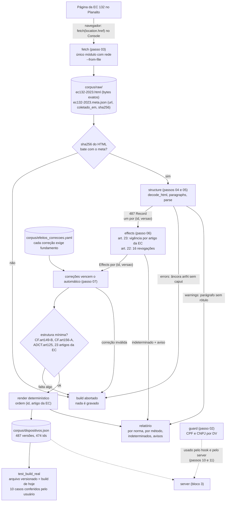
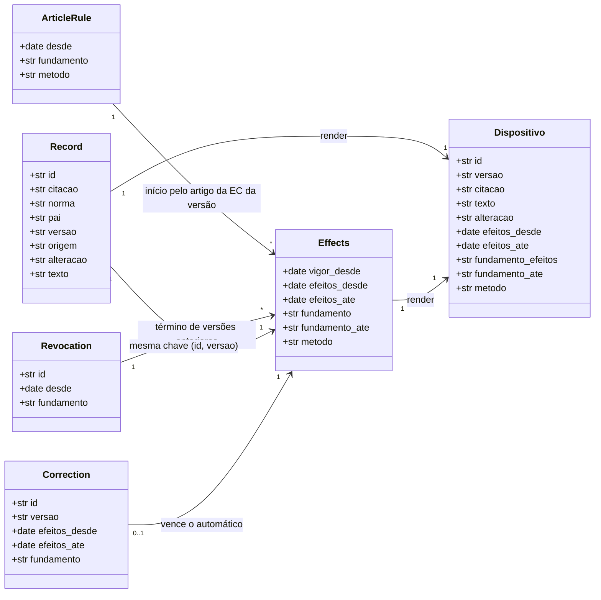

# Bloco 2: corpus (passos 02 a 07)

Diagramas do fim do bloco Corpus: o pipeline que transforma a página do Planalto em `corpus/dispositivos.json` e o modelo de dados que circula entre as etapas.

## Pipeline

O que o diagrama mostra:

- **Rede só na borda.** O `fetch` é o único módulo que poderia acessar a rede, e na prática a coleta foi feita pelo navegador, porque o Planalto derruba clientes automatizados. Daí em diante, tudo é puro e offline.
- **Três saídas possíveis para um problema:** `ABORT` (resultado errado, nada é gravado), `indeterminado` (dado incompleto, registrado como tal) e aviso no relatório. Nenhum problema some em silêncio.
- **O fecho do ciclo:** `test_build_real` compara o arquivo versionado com o que o build gera hoje. Se alguém mudar parser, effects, correções ou HTML sem rodar o build, a suíte quebra.

## Modelo de dados

Leitura do modelo:

- **Chave (`id`, `versao`).** `versao` é o artigo da EC que traz aquele texto (`EC132.art3`). Um mesmo `id` pode ter várias versões, como `CF.art156-A.par1.incIX` nos arts. 1º, 3º e 4º.
- **`pai` pode ser um ancestral omitido**, citado no texto da EC só como linha de pontos (ex.: `CF.art43` para `CF.art43.par4`).
- **`alteracao`:** `incluido` (bloco fechado só com aspas), `alterado` (bloco fechado com "(NR)") ou `original` (texto da própria EC).
- **`metodo`:** `automatico`, `correcao` ou `indeterminado`. Com `indeterminado`, as datas ficam nulas: nunca são inventadas.
- **Datas que podem ser nulas:** `efeitos_ate` nulo quer dizer "sem término conhecido". `fundamento_ate` só existe quando o término vem de uma revogação do art. 22.
- **Formato do arquivo:** até o passo 07, cada registro também levava `fonte_url` e `coletado_em`. Desde o passo 08, eles ficam uma vez só no cabeçalho `fonte` (`url`, `coletado_em`, `sha256_html`), e os registros vão em `dispositivos` (spec, seção 5).
