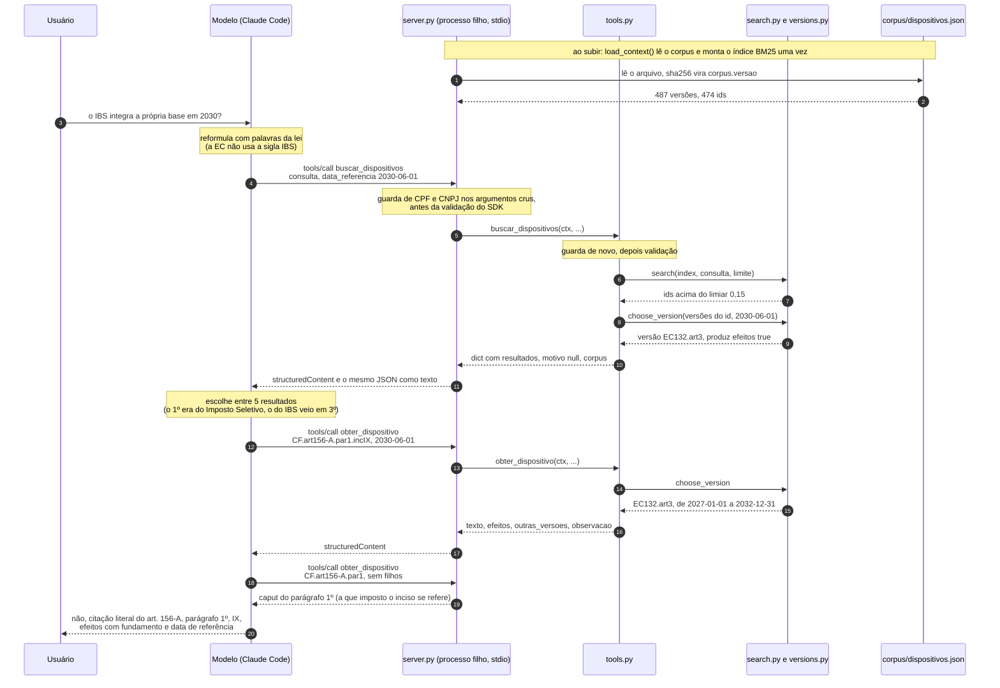

# Bloco 3: server (passos 08 a 10)

Este diagrama mostra a primeira consulta real (2026-11-08, Claude Code com o server `taxlaw` via stdio, revisão `2026-07-28`). A pergunta foi: *"Pela EC 132, o IBS integra a própria base de cálculo em 2030? Cite o dispositivo."*

> Este diagrama é do caminho **local, via stdio**. O caminho remoto (HTTPS, nginx, token) está no [bloco 5](bloco-5-http-deploy.md).

## Sequência de uma consulta

## O que o diagrama mostra

- **Duas camadas de guarda dentro do server.** A primeira roda em `TaxLawServer.call_tool`, antes do SDK, porque o erro de validação do SDK repete o valor recebido. A segunda roda em `tools.py`, para quem chama as funções direto. O hook do passo 11 será a terceira, no cliente, antes de a chamada sair do Claude Code.
- **O server não guarda estado entre chamadas.** Cada `tools/call` traz `data_referencia`, e a resposta ecoa essa data junto com `corpus.versao`. O que fica em memória é o corpus e o índice, carregados uma vez ao subir. Por isso, mudar o `dispositivos.json` só vale depois de reiniciar o server.
- **Decidir é papel do modelo, não do server.** O server devolve dados: os resultados acima do limiar, a versão que vale na data e as outras versões. Reformular a consulta ("IBS" não está no texto) e escolher entre os resultados é com o modelo. Os dois pontos são candidatos a avaliação no P3 e a regra da skill no passo 12.
- **"Não encontrei" e "não sei" são dados.** `encontrado: false` volta com `isError: false`, e `produz_efeitos_na_data: null` é diferente de `false`.
