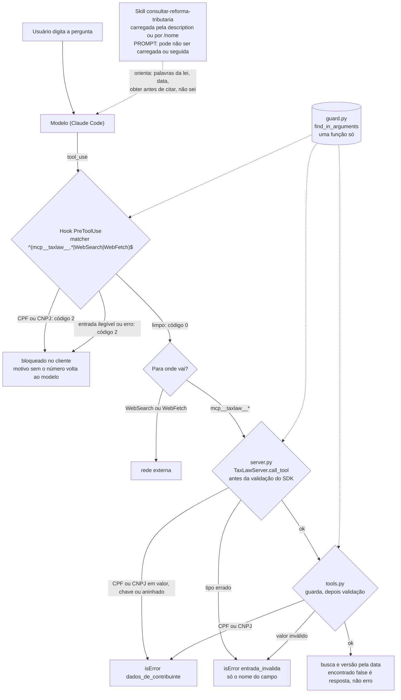

# Bloco 4: harness (passos 11 e 12)

Este diagrama mostra as guardas do P2 e o que cada uma cobre. A regra do P1 vale aqui: **prompt melhora a taxa de acerto; o harness decide o que acontece quando o modelo erra**. A skill é a camada de prompt. O hook, o `server.py` e o `tools.py` são as camadas de código.

> Estas são as guardas do caminho **local**, com o hook do Claude Code. No caminho HTTP não existe o hook, e as proteções (nginx, token, `Host`, tamanho, guarda do server) estão no [bloco 5](bloco-5-http-deploy.md).

## As guardas

## O que cada camada cobre

| Camada | Tipo | Cobre | Não cobre |
|---|---|---|---|
| Skill | prompt | como buscar (palavras da lei), a data, ler antes de citar, os "não sei", efeito não ser cobrança | nada é garantido: o modelo pode não carregar a skill nem segui-la |
| Hook | código, no cliente | `taxlaw`, `WebSearch` e `WebFetch`, antes de sair do Claude Code | o texto digitado (`UserPromptSubmit`), o `Bash` (`curl`), falha do próprio `uv` |
| `server.py` | código, no server | qualquer cliente MCP (Kiro, clientes sem hook), antes do SDK repetir o valor num erro | ferramentas de outros servers e a web |
| `tools.py` | código, na função | chamadas diretas: testes e o P3 | — |

## O que vimos nas consultas reais

- **Hook (passo 11):** `buscar_dispositivos` com um CPF sintético foi bloqueada antes de chegar ao server. A mesma ferramenta, com uma consulta limpa, passou.
- **Sem a skill (passo 10):** o modelo já fez `buscar` → `obter` e passou a data. Mas buscou com palavras da lei por conta própria, e o 1º resultado era do Imposto Seletivo.
- **Com a skill (passo 12, `/consultar-reforma-tributaria`):** a pergunta "qual o percentual do IBS?" virou a busca "alíquota do imposto sobre bens e serviços", com a data explícita. A resposta foi "a EC não fixa um percentual definitivo", com a única alíquota que o texto traz (0,1% em 2026, no ADCT, art. 125), e não um número de memória. De novo, o 1º resultado era do Imposto Seletivo (EC, art. 9º, § 9º).
- **O que ainda não sabemos:** sem `/nome`, com que frequência o modelo carrega a skill sozinho? Essa é uma pergunta para o P3: comparar respostas com e sem a skill, em muitas perguntas.
