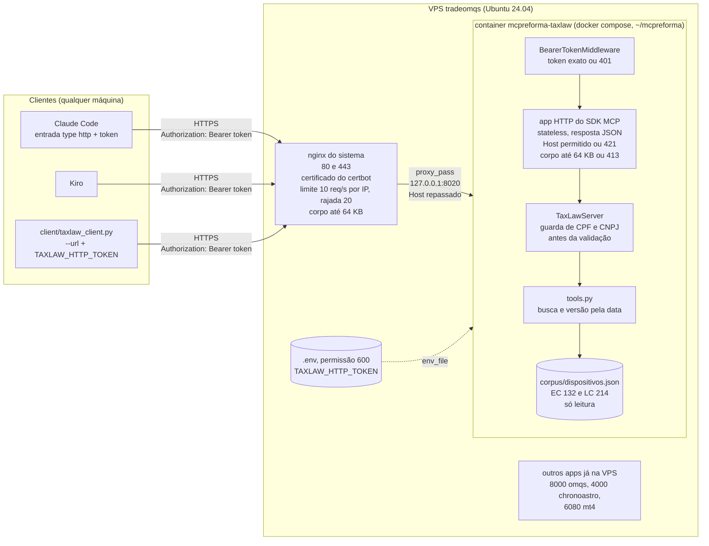
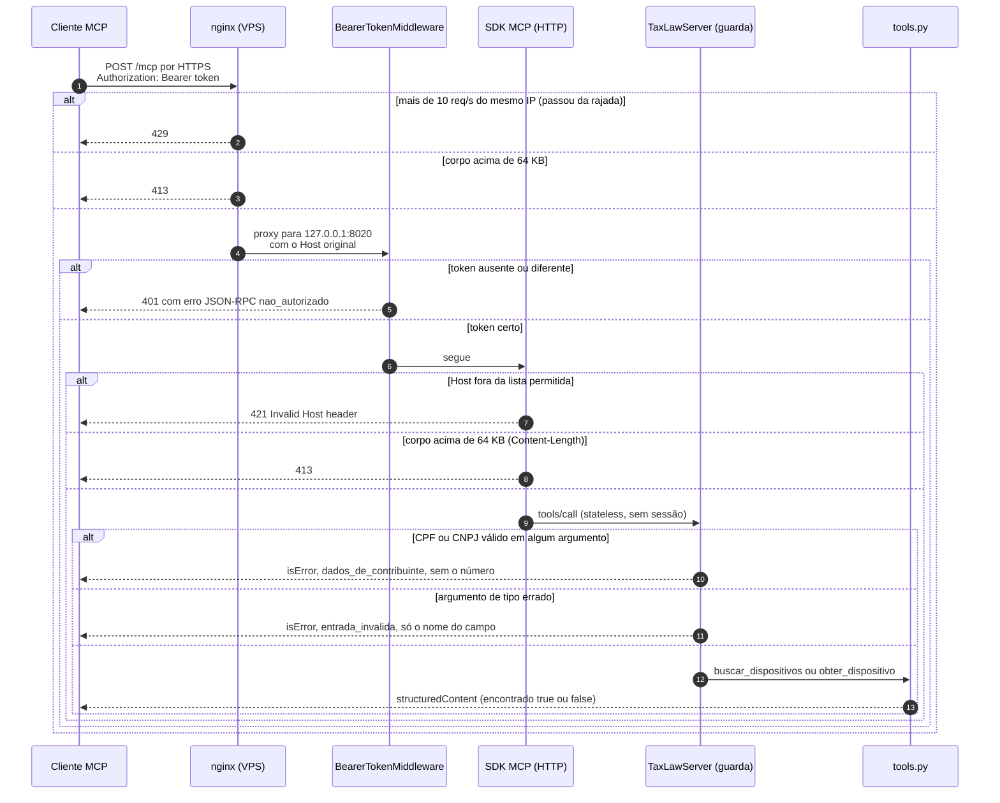

# Bloco 5: o server via HTTP e o deploy na VPS

Estes diagramas mostram o caminho **remoto**, publicado em `https://mcpreforma.cristianocarvalho.cloud/mcp`. O caminho local, com stdio, está no [bloco 3](bloco-3-server.md), e as guardas do caminho local no [bloco 4](bloco-4-harness.md).

A diferença principal: **no caminho HTTP não existe o hook do Claude Code** no meio. Um cliente remoto qualquer fala direto com o server, então a proteção fica toda do lado da VPS, em camadas.

## Arquitetura do deploy

O que o diagrama mostra:

- **Só o nginx fala com a internet.** O container publica a porta só em `127.0.0.1:8020`. Mesmo que o nginx fosse removido, nada de fora alcançaria o container.
- **O container é endurecido:** roda como `uid 10001`, com o sistema de arquivos só de leitura, sem capacidades de kernel, com `no-new-privileges` e com teto de memória e CPU.
- **O token mora num lugar só:** o `.env` da VPS, com permissão 600. Ele não está no git, na imagem nem nos logs, e nunca é impresso na tela: o roteiro o copia direto para a área de transferência do Mac.
- **A porta 8020** foi escolhida porque a 8000 já era de outro app da VPS.

## Sequência de uma requisição

## Quem responde cada código

| Código | Quem responde | Causa | O que fazer |
|---|---|---|---|
| **429** | nginx | mais de 10 req/s por IP, passada a rajada de 20 | esperar e reduzir o ritmo |
| **413** | nginx ou SDK | corpo acima de 64 KB | uma consulta tem até 500 caracteres; o corpo é grande demais |
| **401** | `BearerTokenMiddleware` | token ausente, errado ou com outro esquema | copiar o token da VPS de novo (`docs/deploy.md`, passo 3) |
| **421** | SDK (DNS rebinding) | o `Host` não é o `TAXLAW_ALLOWED_HOST` | conferir o domínio usado e o `TAXLAW_ALLOWED_HOST` do container |
| **502** | nginx | o container não está de pé | `docker compose ps` e `docker compose logs` |
| 200 com `isError` | `TaxLawServer` ou `tools.py` | `dados_de_contribuinte` ou `entrada_invalida` | corrigir a consulta; o número de CPF/CNPJ nunca volta |
| 200 com `encontrado: false` | `tools.py` | nada acima do limiar, ou id inexistente | é uma resposta válida, não um erro |

## Comparação com o caminho local (stdio)

| | stdio (Claude Code e Kiro, blocos 3 e 4) | HTTP (este bloco) |
|---|---|---|
| Quem sobe o server | o cliente, como processo filho | o Docker na VPS, sempre rodando |
| Identidade | quem consegue rodar o processo | quem tem o token |
| Hook do Claude Code | sim, antes de a chamada sair | **não**: a chamada já chega pela rede |
| Guarda de CPF/CNPJ | no hook, no server e no `tools.py` | no server e no `tools.py` |
| Proteções a mais | nenhuma necessária | HTTPS, limite de taxa, token, `Host`, tamanho |
